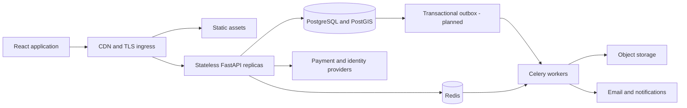

# Architecture review and production scaling plan

Reviewed baseline: `1974dea3f0efb1fd87eb86bee4942bf4452f0dc3` on 2026-10-16.

## Assessment

The project is a modular application scaffold with some working marketplace services. Its existing stack is suitable for an initial production marketplace. The immediate constraint is incomplete and unsafe business flows, rather than a need for more infrastructure. No traffic target, country rollout, production database state, or operating budget has been confirmed; capacity numbers below are proposed acceptance targets, not measured guarantees.

The repository contains a React 18/TypeScript/Vite SPA using Axios and Zustand; a FastAPI API grouped by domain; SQLAlchemy repositories and PostgreSQL/PostGIS models; Redis and Celery workers; payment, identity, mapping, storage, and notification adapters; and Docker/Nginx deployment assets. Thirty-five API modules contain scaffold/placeholder declarations. Search, nearby dispatch, and invoice PDF rendering raise `NotImplementedError`. Several API and end-to-end tests are skipped or placeholders.

## Recommended architecture

Retain one API deployment and explicit domain boundaries while completing the marketplace. Each API replica should be stateless; PostgreSQL owns durable business state, Redis owns short-lived coordination, and workers handle retryable background work. Share provider interfaces and business services between request handlers and workers. Keep privileged operations under explicit role and resource authorization.

The outbox in this diagram is a target design, not implemented by this PR. Use the existing modules as bounded domains: identity/access; catalog/professional profiles; orders/checkout/inventory; payments/refunds/payouts; fulfillment; communications; verification; and administration/audit. Keep API handlers thin and let services own authorization, business rules, and transaction boundaries. Avoid splitting these into independent services until measured traffic or team ownership warrants it.

## Fixes proposed in this PR

| Finding | Change |
| --- | --- |
| Public signup accepts `admin` through an unrestricted role string and enum check | Restrict the request schema and service allowlist to public roles |
| Wildcard credentialed CORS; weak production settings accepted | Use configured origins and reject unsafe staging/production settings |
| Limiter configured without enforcement middleware; authentication limits only documented | Install shared limiter middleware and apply authentication endpoint limits; require Redis storage in production |
| Database module references an undefined `Generator`, lacks imported health/session helpers, and rewrites specific database URLs | Restore explicit sessions, rollback and health helpers, remove host-specific URL rewriting, bound connection waits |
| Readiness returns HTTP 200 when dependencies fail | Return 503 for failed readiness; keep liveness independent |
| Payment endpoints lack buyer ownership checks and settlements lack identity checks | Validate buyer ownership, reference, exact amount, and currency before accepting provider results |
| Missing webhook secrets can validate as empty strings; Paystack signs with the wrong setting | Fail closed and use the Paystack account secret; validate bounded payloads after signature verification |
| Customer cancellation and delivery transitions lack complete resource ownership checks | Check the buyer and assigned courier; reject client-driven payment transitions |
| Refresh 401 re-enters its own Axios interceptor and waits forever | Use an isolated refresh transport and one refresh promise per API client |
| CI workflows live below `backend/.github`, where GitHub does not run them | Add a repository-root workflow with backend and frontend checks |
| Container lacks a real health check and runs as root | Run as a non-root user, use an explicit health check, and keep ports consistent |

Production configuration now requires `APP_ENV=production`, `DEBUG=false`, `DATABASE_ECHO=false`, a random secret of at least 32 characters, explicit HTTPS origins in a JSON array, and Redis-backed `RATE_LIMIT_STORAGE_URI`. Example values are not production credentials. Only trust forwarding headers from the deployment's known ingress; otherwise clients can spoof IP-based rate-limit keys. Configure aggregate connection limits as `replicas × workers × (pool_size + max_overflow)` within the database's connection budget, preferably with a pooler.

## Remaining launch blockers

These are not fixed by this PR and must remain visible during review.

1. **Payment transaction durability:** `PaymentService` commits payment success before order/payout/notification work finishes. A Redis lock can suppress retries after a failed attempt, and a committed provider-event row can be mistaken for a completed event. Move settlement, order transition, payout ledger entries, and outbox records into one PostgreSQL transaction, use durable provider/event uniqueness and row locks, then retry idempotent outbox consumers. Test crashes at every boundary, duplicate and out-of-order deliveries, provider outages, and reconciliation. Treat this as a release blocker for live money.
2. **Authoritative pricing and order items:** customer order creation trusts client unit prices and does not persist the submitted line items. Resolve published designs or approved quotes server-side, snapshot validated prices with `Decimal`, enforce currency consistency, and persist items atomically. Custom requests need a quote/acceptance lifecycle before payment.
3. **Migration history:** `0002` and `035e1bd61029` both descend from `0001`, but `0002` alters tables created by the initial-tables branch. The merge revision alone does not guarantee dependency order. Inventory every deployed Alembic revision before choosing a forward repair or a baseline for fresh installs. Do not rewrite applied history blindly. Prove upgrade on an empty PostGIS database and a sanitized copy of every supported existing revision, with backup and restoration rehearsals.
4. **Checkout and inventory:** multi-vendor payment grouping is described but not implemented as a complete durable flow; cart/vendor identifiers contain placeholders, stock reservation expiry is absent, and snapshot prices can become stale. Lock cart and inventory rows, aggregate quantities, validate ownership, add reservation expiry/release and idempotency, and test two buyers competing for the last item.
5. **Authentication lifecycle:** add one-time password reset tokens, atomic refresh rotation/reuse detection, session expiry/uniqueness constraints, verified-account policies, and MFA for privileged accounts. Browser tokens remain JavaScript-accessible; evaluate an HttpOnly cookie/BFF session architecture with explicit CSRF protection before a wider release.
6. **Incomplete user journeys:** complete catalog discovery, profile provisioning, addresses, measurements, checkout, tracking, delivery assignment, reviews, invoice generation/storage, refunds, dispute handling, and administration. Replace successful-looking placeholders with implemented behavior or explicit unavailable states.
7. **Data integrity and privacy:** most UUID associations do not have foreign keys. Add constraints and indexes through reviewed migrations after checking existing data. Separate public profile/portfolio assets from private KYC documents; enforce signed access, encryption, retention/deletion, audit coverage, and least privilege. Do not log sensitive identity payloads or payment secrets.
8. **Test coverage:** replace skipped API and end-to-end placeholders with complete role-based flows. A test asserting `NotImplementedError` proves an unfinished contract, not readiness. Add concurrency and failure-injection tests using real PostGIS/Redis and sandbox payment accounts.
9. **Dependency and platform security:** review the pinned backend packages and frontend lockfile with vulnerability scanning, upgrade affected direct/transitive dependencies, and verify compatibility. A version pin is not evidence of security. Add dependency update automation, image scanning, and an SBOM once the build is stable.

## Delivery stages and acceptance gates

| Stage | Deliverables | Acceptance gate |
| --- | --- | --- |
| Foundation, this PR | Targeted security/operational fixes, regression tests, executable CI, this review | Review diff; run full CI; preserve explicit open launch blockers |
| Transactional marketplace | Server-owned prices, persisted items, safe migrations, durable settlement/outbox, inventory reservations, complete invoices/refunds | Signup → discover → quote/order → pay → fulfill → receive → invoice works; wrong-user requests fail; repeated callbacks cannot create duplicate financial effects |
| Regional production | Managed PostGIS, managed Redis, private object storage, worker queues, staging, backups, monitoring, privileged MFA | Restore rehearsal passes; alerts reach an owner; agreed SLOs and incident/rollback runbooks tested |
| International expansion | Country capability registry, local payment/shipping/tax integrations, language/currency/unit handling, privacy processes | Each enabled country passes its own payment, tax, delivery, support, and regulatory readiness review |
| Measured scale | CDN, query/index tuning, connection pooling, independent workers, then replicas/caches/search where justified | Load tests meet SLOs without overselling, double charging, data leakage, or exceeding cost/connection budgets |

Start in one primary write region with managed failover and CDN delivery worldwide. Do not use multi-region writes for orders/payments without a proven consistency model. Route country-specific payment, delivery, verification, tax, and currency capabilities through explicit configuration; display unsupported markets honestly. Do not infer that accepting a currency provides shipping, tax, consumer support, or regulatory coverage in that country.

For internationalization, centralize translations and locale selection; use `Intl` formatting and explicit IANA timezones; store money as exact decimal values with currency and currency-specific minor-unit rules; normalize phone numbers to E.164; model structured addresses by country; keep measurement units explicit; support keyboard, screen-reader, contrast, and mobile flows to WCAG 2.2 AA. Provider adapters currently have NGN/two-decimal assumptions that must be reviewed before enabling additional currencies.

## Operations and scaling verification

Proposed initial targets to agree with the product owner: 99.9% monthly availability for the ordering API; p95 below 500 ms for ordinary reads and 1 s for ordinary writes excluding external provider latency; zero duplicate settlements and no overselling; database restore point within 15 minutes and recovery within 60 minutes. Validate and revise these against business cost, traffic, and provider constraints.

Measure API latency/errors/throughput by route, database pool utilization and slow queries, Redis errors, worker queue depth/oldest job age/retries, webhook lag, unmatched settlements, inventory shortfalls, and payout reconciliation. Propagate request/event identifiers into structured logs and tracing. Exclude secrets and private documents. Define payment-error and queue-backlog alerts with an owner and a runbook.

Load-test catalog reads, concurrent checkout, webhook bursts, and queue recovery with a production-like dataset. Add composite indexes based on actual query plans, use keyset pagination for large feeds, cache public catalog reads with bounded TTLs, and invalidate after writes. Add search infrastructure only when Postgres full-text/PostGIS searches no longer meet measured requirements. Keep private/order/payment responses out of shared CDN caches.

Run migrations once as a reviewed release step, not independently in every API replica. Deploy to staging, smoke-test all personas, test backward compatibility with the prior application image, then release gradually with rollback instructions. Preserve financial/audit records during rollback. Back up database and object storage independently and test restoration regularly.

## Verification record

Local environment: Python 3.12 and Node 24 are installed, but the workspace network proxy cannot reach GitHub/package registries. Source was obtained through the authenticated GitHub connection. Seven dependency-light settlement/configuration tests pass, Python compilation passes, and static local-import checks pass. Full PostgreSQL/Redis service tests, frontend lint/build/Vitest, Docker build, and browser end-to-end verification require the configured CI runner or a development machine with package access. CI results on the PR are the authoritative record for those checks; no production deployment or load test has been performed.
